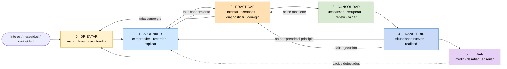

# 01 - Mapa maestro

[[00 - Inicio|← Inicio]]

## Cómo leer el mapa

El flujo principal avanza de izquierda a derecha, pero **no es una escalera**. Cada fase produce evidencia que puede obligar a regresar. El retorno correcto depende del diagnóstico descrito en [[08 - Diagnóstico de fallas]].

### Navegación

[[02 - Orientar|0 · Orientar]] → [[03 - Aprender|1 · Aprender]] → [[04 - Practicar|2 · Practicar]] → [[05 - Consolidar|3 · Consolidar]] → [[06 - Transferir|4 · Transferir]] → [[07 - Elevar|5 · Elevar]]

## La pregunta que gobierna el sistema

> [!question]
> **¿Qué evidencia demuestra que realmente mejoré, y qué es ahora lo que más limita mi siguiente mejora?**

La idea de definir objetivos observables y utilizar feedback para ajustar el desempeño se apoya, entre otros, en la teoría de establecimiento de metas y en la literatura sobre feedback.[^locke][^hattie]

[^locke]: Locke, E. A., & Latham, G. P. (2002). *Building a practically useful theory of goal setting and task motivation: A 35-year odyssey*. American Psychologist, 57(9), 705–717. https://doi.org/10.1037/0003-066X.57.9.705
[^hattie]: Hattie, J., & Timperley, H. (2007). *The Power of Feedback*. Review of Educational Research, 77(1), 81–112. https://doi.org/10.3102/003465430298487
