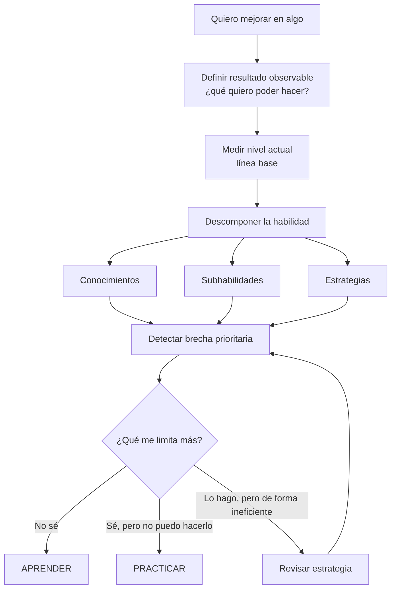

# 02 - Orientar

[[01 - Mapa maestro|← Mapa maestro]] · [[03 - Aprender|Siguiente → Aprender]]

> [!goal] Objetivo de la fase
> Convertir un interés amplio en una **capacidad observable**, medir el punto de partida y elegir la brecha prioritaria.

## Qué hacer

1. Escribir una meta como **conducta o resultado observable**, no como intención vaga.
2. Crear una línea base con una prueba, producto, grabación, tiempo, tasa de error o criterio equivalente.
3. Descomponer la competencia en partes entrenables.
4. Seleccionar **una brecha prioritaria**: la que más limita el siguiente salto.

## Ejemplo

“Quiero aprender guitarra” es demasiado amplio. Una formulación operativa podría ser:

- cambiar entre cuatro acordes sin detener el tempo;
- mantener 90 BPM durante una canción completa;
- identificar una progresión armónica sencilla de oído.

La investigación de Locke y Latham resume décadas de evidencia de que metas específicas y desafiantes, cuando son apropiadas para la tarea y acompañadas por compromiso y feedback, suelen orientar mejor el desempeño que objetivos vagos.[^locke]

> [!warning]
> En tareas complejas o nuevas, una meta de resultado demasiado exigente puede ser menos útil que una **meta de aprendizaje**: primero descubrir el método correcto, luego exigir rendimiento.

## Salida de esta fase

- Resultado deseado:
- Línea base:
- Subhabilidades:
- Brecha prioritaria:
- Evidencia que usaré para saber si mejoré:

## Conexiones

- Si falta saber qué hacer → [[03 - Aprender]].
- Si se sabe qué hacer pero no sale → [[04 - Practicar]].
- Para elegir correctamente → [[08 - Diagnóstico de fallas]].

[^locke]: Locke, E. A., & Latham, G. P. (2002). *Building a practically useful theory of goal setting and task motivation: A 35-year odyssey*. American Psychologist, 57(9), 705–717. https://doi.org/10.1037/0003-066X.57.9.705
