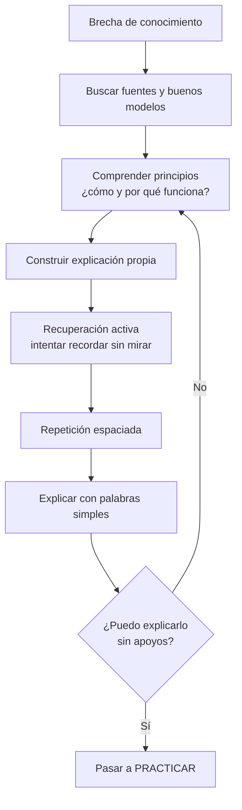

# 03 - Aprender

[[02 - Orientar|← Orientar]] · [[01 - Mapa maestro|Mapa maestro]] · [[04 - Practicar|Practicar →]]

> [!goal] Objetivo de la fase
> Comprender lo suficiente para poder **recuperar, explicar y empezar a actuar**, sin esperar a “saber todo”.

## Herramientas principales

### Recuperación activa

Intentar recuperar la información de memoria es más que una evaluación: puede fortalecer la retención posterior. En los experimentos clásicos de Roediger y Karpicke, volver a estudiar elevó el rendimiento inmediato, pero la recuperación mediante pruebas produjo mejor retención en pruebas demoradas.[^roediger]

### Repetición espaciada

Distribuir los encuentros con el contenido a lo largo del tiempo mejora, en promedio, la retención frente a concentrarlos en una sola sesión. Una revisión cuantitativa de Cepeda y colegas reunió 839 evaluaciones procedentes de 317 experimentos.[^cepeda]

### Autoexplicación

Explicar con palabras propias obliga a integrar la nueva información con el conocimiento previo. Chi y colegas mostraron mejoras de comprensión cuando estudiantes fueron inducidos a autoexplicar un texto científico.[^chi]

## Regla de salida

No preguntar únicamente “¿lo reconozco cuando lo veo?”. Preguntar:

- ¿Puedo recuperarlo sin mirar?
- ¿Puedo explicarlo con mis palabras?
- ¿Puedo decir cuándo se aplica y cuándo no?
- ¿Sé lo suficiente para intentar una tarea real?

> [!warning] Ilusión de fluidez
> Releer o reconocer algo puede producir sensación de dominio sin garantizar que se pueda recuperar después. La literatura de autorregulación documenta errores frecuentes al juzgar cuánto hemos aprendido.[^bjork]

## No convertir esta fase en procrastinación sofisticada

Aprender debe llevar pronto a [[04 - Practicar]]. La práctica revela vacíos que el estudio previo no puede anticipar.

[^roediger]: Roediger, H. L., & Karpicke, J. D. (2006). *Test-enhanced learning: Taking memory tests improves long-term retention*. Psychological Science, 17(3), 249–255. https://doi.org/10.1111/j.1467-9280.2006.01693.x
[^cepeda]: Cepeda, N. J., Pashler, H., Vul, E., Wixted, J. T., & Rohrer, D. (2006). *Distributed practice in verbal recall tasks: A review and quantitative synthesis*. Psychological Bulletin, 132(3), 354–380. https://doi.org/10.1037/0033-2909.132.3.354
[^chi]: Chi, M. T. H., de Leeuw, N., Chiu, M.-H., & LaVancher, C. (1994). *Eliciting self-explanations improves understanding*. Cognitive Science, 18(3), 439–477. https://doi.org/10.1207/s15516709cog1803_3
[^bjork]: Bjork, R. A., Dunlosky, J., & Kornell, N. (2013). *Self-Regulated Learning: Beliefs, Techniques, and Illusions*. Annual Review of Psychology, 64, 417–444. https://doi.org/10.1146/annurev-psych-113011-143823
