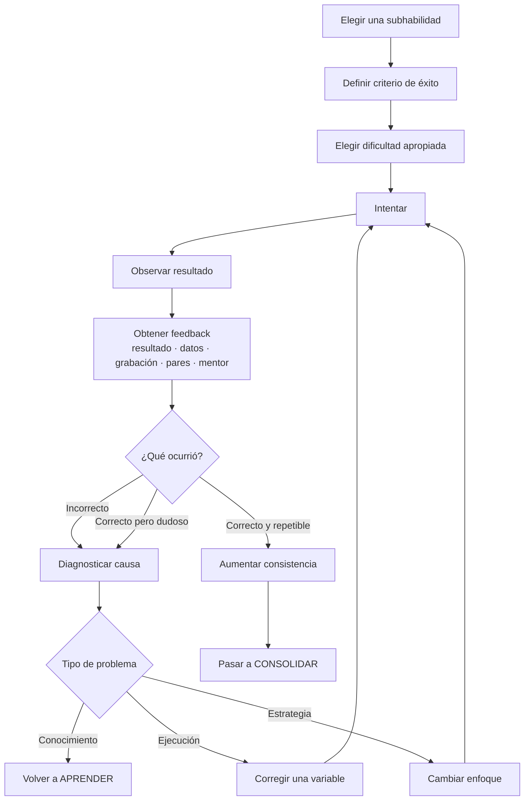

# 04 - Practicar

[[03 - Aprender|← Aprender]] · [[01 - Mapa maestro|Mapa maestro]] · [[05 - Consolidar|Consolidar →]]

> [!goal] Objetivo de la fase
> Transformar comprensión en capacidad mediante intentos enfocados, feedback, diagnóstico y corrección.

## Práctica deliberada: cómo la usamos aquí

El trabajo clásico de Ericsson, Krampe y Tesch-Römer enfatizó actividades estructuradas específicamente para mejorar aspectos del rendimiento, con atención y oportunidades de corrección.[^ericsson] En este sistema usamos la idea de manera prudente: **objetivo específico + tarea enfocada + feedback + corrección + repetición**.

No asumimos que la práctica deliberada explique por sí sola la excelencia. Una metaanálisis de Macnamara y colegas encontró que explica una proporción relevante pero limitada de la variación de desempeño y que el tamaño de esa relación cambia mucho por dominio.[^macnamara]

## El feedback ocurre también cuando “salió bien”

El nodo de feedback está **antes** de decidir si el resultado fue realmente bueno. Esto evita cuatro errores posibles:

1. salió mal y sé por qué;
2. salió mal y no sé por qué;
3. salió bien y sé por qué;
4. **salió bien pero no sé por qué**.

La literatura sobre feedback muestra que su efecto depende mucho de su contenido, nivel y forma; “más feedback” no es automáticamente mejor.[^hattie]

## Unidad mínima de mejora

> **Intento → evidencia → feedback → diagnóstico → una corrección → nuevo intento.**

Corregir una variable a la vez facilita saber qué cambio produjo qué efecto.

## Criterio para avanzar

No avanzar por un solo acierto. Buscar **consistencia** bajo el mismo nivel de dificultad antes de pasar a [[05 - Consolidar]].

## Si la práctica se estanca

Usar [[08 - Diagnóstico de fallas]] antes de hacer más repeticiones. Repetir un error sin cambiar información, atención o estrategia solo automatiza el patrón equivocado.

[^ericsson]: Ericsson, K. A., Krampe, R. T., & Tesch-Römer, C. (1993). *The role of deliberate practice in the acquisition of expert performance*. Psychological Review, 100(3), 363–406. https://doi.org/10.1037/0033-295X.100.3.363
[^macnamara]: Macnamara, B. N., Hambrick, D. Z., & Oswald, F. L. (2014). *Deliberate practice and performance in music, games, sports, education, and professions: A meta-analysis*. Psychological Science, 25(8), 1608–1618. https://doi.org/10.1177/0956797614535810
[^hattie]: Hattie, J., & Timperley, H. (2007). *The Power of Feedback*. Review of Educational Research, 77(1), 81–112. https://doi.org/10.3102/003465430298487
