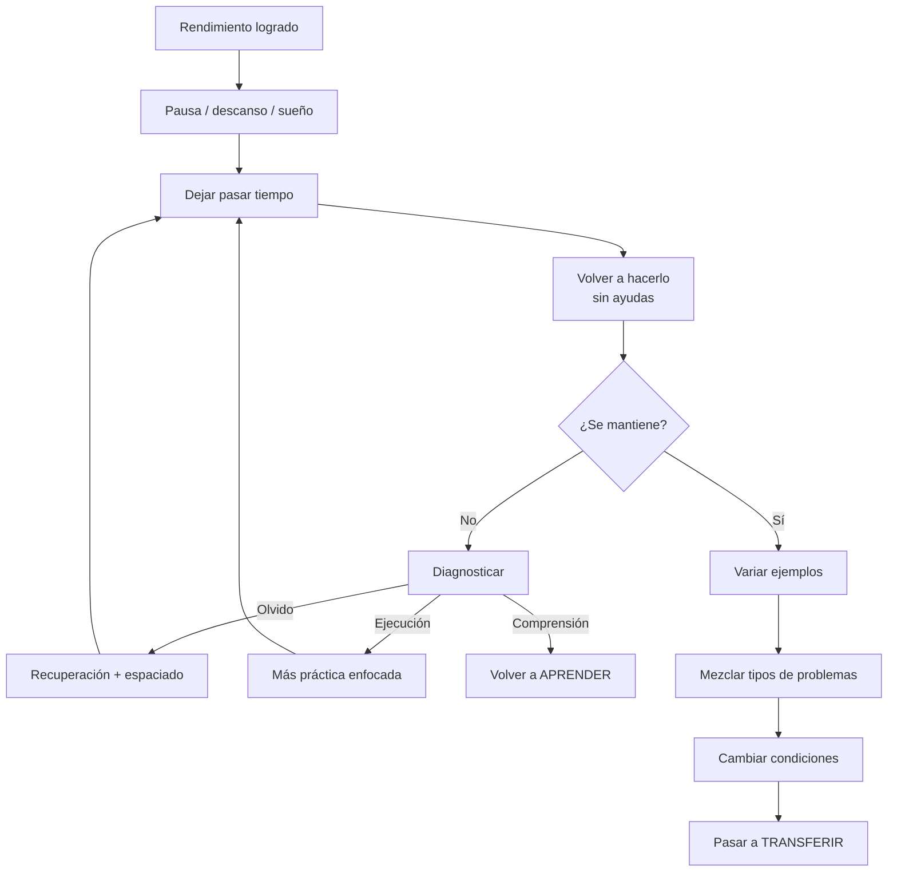

# 05 - Consolidar

[[04 - Practicar|← Practicar]] · [[01 - Mapa maestro|Mapa maestro]] · [[06 - Transferir|Transferir →]]

> [!goal] Objetivo de la fase
> Comprobar que el desempeño **sobrevive al tiempo y a la retirada de ayudas**.

## Rendimiento no es lo mismo que aprendizaje

Una persona puede rendir bien durante la sesión y fallar al día siguiente. La diferencia entre desempeño durante la práctica y retención posterior es una razón para introducir una **prueba demorada sin ayudas**.[^bjork]

## Sueño y memoria

El sueño participa en procesos de consolidación de memoria. La revisión de Rasch y Born sintetiza evidencia conductual y neurofisiológica sobre el papel del sueño en la estabilización y reorganización de memorias.[^rasch]

> [!note]
> Dormir no sustituye a estudiar o practicar; es una condición de apoyo para que lo entrenado tenga oportunidades de consolidarse.

## Espaciar y variar

Tras conseguir una respuesta estable, conviene volver a recuperarla después de un intervalo. El espaciado cuenta con evidencia amplia para retención a largo plazo.[^cepeda]

El **interleaving** o mezcla de tipos de problemas puede ayudar a aprender a discriminar qué procedimiento corresponde a cada caso. Rohrer y Taylor encontraron ventajas sustanciales en una prueba demorada de matemáticas cuando la práctica fue mezclada frente a bloqueada, aunque el beneficio del interleaving depende del dominio y de la tarea.[^rohrer]

## Prueba de consolidación

- [ ] Dejé pasar un intervalo razonable.
- [ ] Retiré apuntes, ejemplos y ayudas.
- [ ] Pude recuperar o ejecutar la habilidad.
- [ ] El desempeño no depende de una única secuencia memorizada.
- [ ] Probé variaciones del mismo tipo de tarea.

[^bjork]: Bjork, R. A., Dunlosky, J., & Kornell, N. (2013). *Self-Regulated Learning: Beliefs, Techniques, and Illusions*. Annual Review of Psychology, 64, 417–444. https://doi.org/10.1146/annurev-psych-113011-143823
[^rasch]: Rasch, B., & Born, J. (2013). *About sleep's role in memory*. Physiological Reviews, 93(2), 681–766. https://doi.org/10.1152/physrev.00032.2012
[^cepeda]: Cepeda, N. J., Pashler, H., Vul, E., Wixted, J. T., & Rohrer, D. (2006). *Distributed practice in verbal recall tasks: A review and quantitative synthesis*. Psychological Bulletin, 132(3), 354–380. https://doi.org/10.1037/0033-2909.132.3.354
[^rohrer]: Rohrer, D., & Taylor, K. (2007). *The shuffling of mathematics practice problems boosts learning*. Instructional Science, 35, 481–498. https://doi.org/10.1007/s11251-007-9015-8
