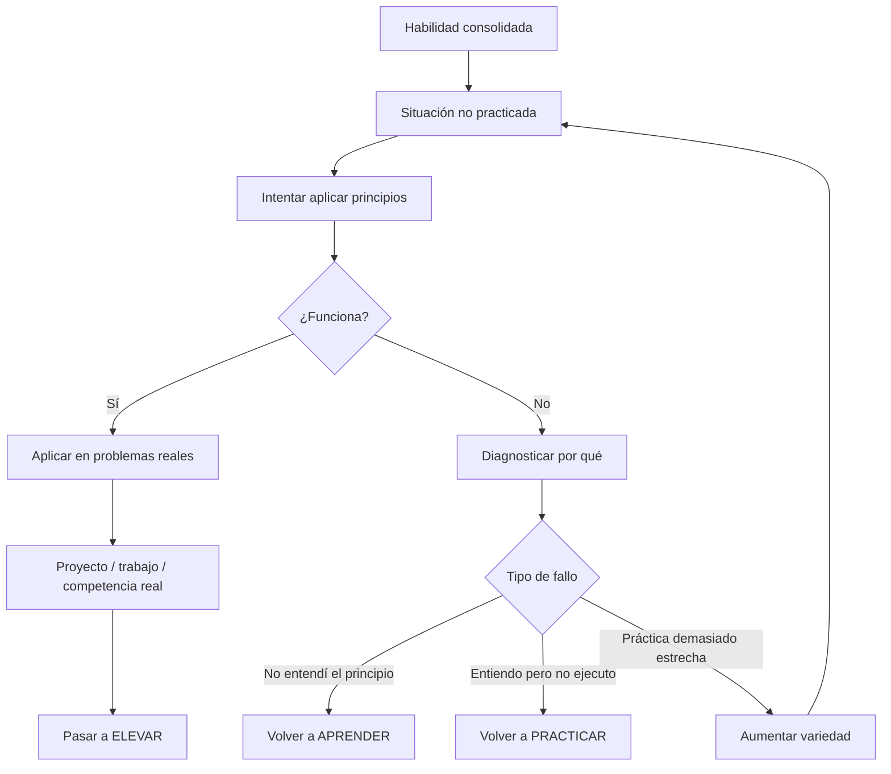

# 06 - Transferir

[[05 - Consolidar|← Consolidar]] · [[01 - Mapa maestro|Mapa maestro]] · [[07 - Elevar|Elevar →]]

> [!goal] Objetivo de la fase
> Comprobar que lo aprendido funciona en condiciones que **no son una copia del entrenamiento**.

## Qué entendemos por transferencia

Transferir significa utilizar conocimientos o habilidades adquiridos en un contexto para resolver otro problema, contexto o formato. Barnett y Ceci mostraron que “transferencia lejana” no es una sola cosa: depende de dimensiones como dominio de conocimiento, contexto físico y social, modalidad, función y distancia temporal.[^barnett]

Esto justifica que la pregunta no sea simplemente “¿transfiere o no?”, sino:

- ¿qué cambió respecto del entrenamiento?
- ¿qué principio se mantiene?
- ¿qué información nueva exige el contexto?
- ¿el fallo fue de conocimiento, ejecución o estrategia?

## Diseñar transferencia

Para aumentar la probabilidad de generalización:

1. variar ejemplos y condiciones;
2. comparar casos similares y diferentes;
3. explicar el principio que conecta los casos;
4. practicar la **selección** del método, no solo su ejecución;
5. usar problemas reales donde las pistas no estén organizadas para el aprendiz.

> [!warning]
> Resolver muchas veces el mismo formato puede producir especialización estrecha. Por eso el sistema separa [[05 - Consolidar|consolidar]] de **transferir**.

## Evidencia de salida

No basta con “lo hice en otro ejercicio”. Registrar qué dimensiones cambiaron: contexto, formato, tiempo, complejidad, restricciones, información disponible y necesidad de elegir estrategia.

[^barnett]: Barnett, S. M., & Ceci, S. J. (2002). *When and where do we apply what we learn? A taxonomy for far transfer*. Psychological Bulletin, 128(4), 612–637. https://doi.org/10.1037/0033-2909.128.4.612
