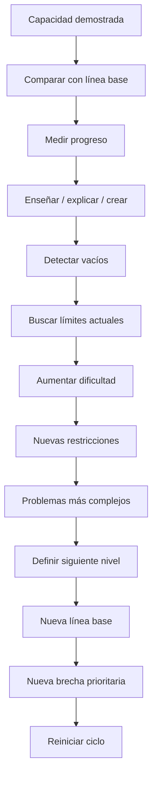

# 07 - Elevar

[[06 - Transferir|← Transferir]] · [[01 - Mapa maestro|Mapa maestro]] · [[02 - Orientar|Reiniciar → Orientar]]

> [!goal] Objetivo de la fase
> Convertir un nivel alcanzado en el punto de partida del siguiente ciclo.

## Medir contra la línea base

La mejora necesita una comparación concreta: tiempo, precisión, calidad, independencia, complejidad, variabilidad de contextos resueltos o cualquier indicador relevante para la habilidad.

## Enseñar como prueba, no como mito

“Enseñar para aprender” tiene evidencia, pero conviene describirlo con precisión y no simplemente llamarlo “método Feynman”. Una metaanálisis de 2024 encontró que enseñar después de estudiar puede beneficiar el aprendizaje, y que el beneficio es mayor cuando la persona **estudia desde el inicio esperando tener que enseñar**.[^kobayashi]

En este sistema, enseñar sirve para:

- obligar a organizar el conocimiento;
- formular explicaciones causales;
- detectar saltos lógicos;
- descubrir qué no se puede responder;
- generar la siguiente lista de brechas.

## Elevar no significa solo “hacer más difícil”

La dificultad puede aumentar por diferentes dimensiones:

- menos tiempo;
- menos ayudas;
- mayor precisión;
- más variables simultáneas;
- condiciones desconocidas;
- restricciones reales;
- necesidad de justificar decisiones;
- responsabilidad por enseñar o diseñar para otros.

El resultado final de esta fase es una **nueva orientación**, no un punto final.

[^kobayashi]: Kobayashi, K. (2024). *Interactive Learning Effects of Preparing to Teach and Teaching: a Meta-Analytic Approach*. Educational Psychology Review, 36, 26. https://doi.org/10.1007/s10648-024-09871-4
