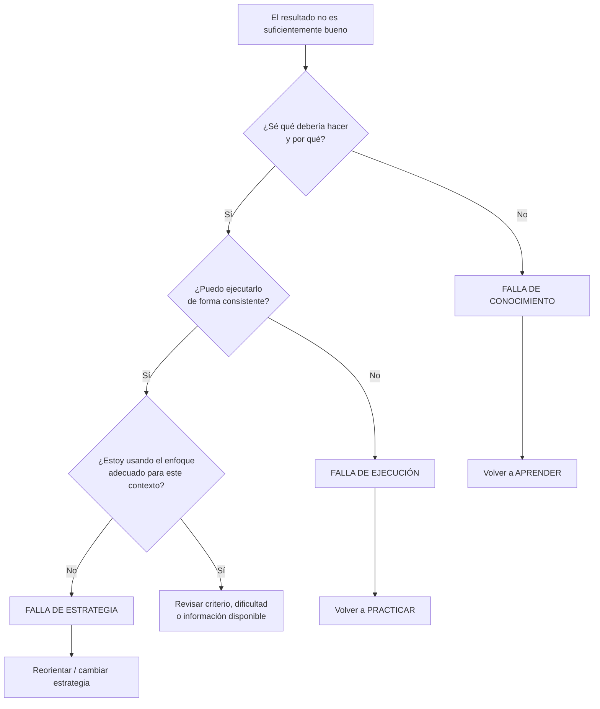

# 08 - Diagnóstico de fallas

[[01 - Mapa maestro|← Mapa maestro]]

> [!important] Núcleo del sistema
> **No practiques simplemente más. Descubre qué te impide mejorar y actúa específicamente sobre esa limitación.**

Esta clasificación es una **herramienta de diseño propia del sistema**. No procede literalmente de una única teoría o estudio. Integra distinciones habituales entre conocimiento declarativo/procedimental, ejecución, selección de estrategias, autorregulación y feedback.

## 1. Falla de conocimiento

**Síntoma:** no sé qué hacer, no entiendo el principio, no puedo explicar la decisión.

Preguntas:
- ¿Qué concepto me falta?
- ¿Puedo explicar el mecanismo?
- ¿Reconozco cuándo esta regla deja de aplicar?

Respuesta típica: [[03 - Aprender]].

## 2. Falla de ejecución

**Síntoma:** sé lo que debería hacer, pero no lo consigo con velocidad, precisión o consistencia.

Preguntas:
- ¿Qué microhabilidad falla?
- ¿En qué momento exacto aparece el error?
- ¿Qué variable puedo aislar?

Respuesta típica: [[04 - Practicar]].

## 3. Falla de estrategia

**Síntoma:** puedo ejecutar procedimientos, pero elegí mal el método, prioricé mal o no me adapté al contexto.

Preguntas:
- ¿Estoy resolviendo el problema correcto?
- ¿Elegí el método correcto para estas condiciones?
- ¿Qué señal del contexto ignoré?

Respuesta típica: [[02 - Orientar]] o volver a variar casos en [[06 - Transferir]].

## ¿Por qué esta distinción es útil?

La literatura de autorregulación muestra que las personas pueden juzgar mal lo que saben y gestionar de forma ineficiente su propio aprendizaje.[^bjork] El feedback solo puede ayudar si se convierte en información accionable acerca de la tarea, el proceso o la autorregulación, no en una evaluación global de la persona.[^hattie]

> [!example] Ejemplo: programación
> - **Conocimiento:** no entiendo complejidad temporal.
> - **Ejecución:** entiendo el algoritmo, pero cometo errores implementándolo.
> - **Estrategia:** puedo implementarlo, pero elegí un algoritmo inadecuado para el tamaño y restricciones del problema.

## Regla de oro

> **Antes de repetir, diagnosticar.**

[^bjork]: Bjork, R. A., Dunlosky, J., & Kornell, N. (2013). *Self-Regulated Learning: Beliefs, Techniques, and Illusions*. Annual Review of Psychology, 64, 417–444. https://doi.org/10.1146/annurev-psych-113011-143823
[^hattie]: Hattie, J., & Timperley, H. (2007). *The Power of Feedback*. Review of Educational Research, 77(1), 81–112. https://doi.org/10.3102/003465430298487
